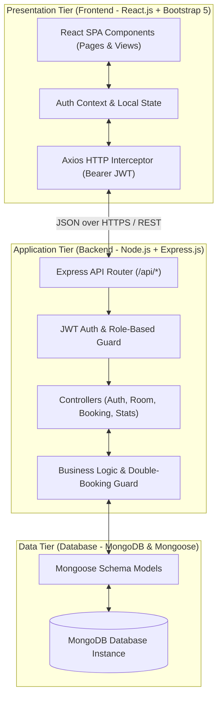
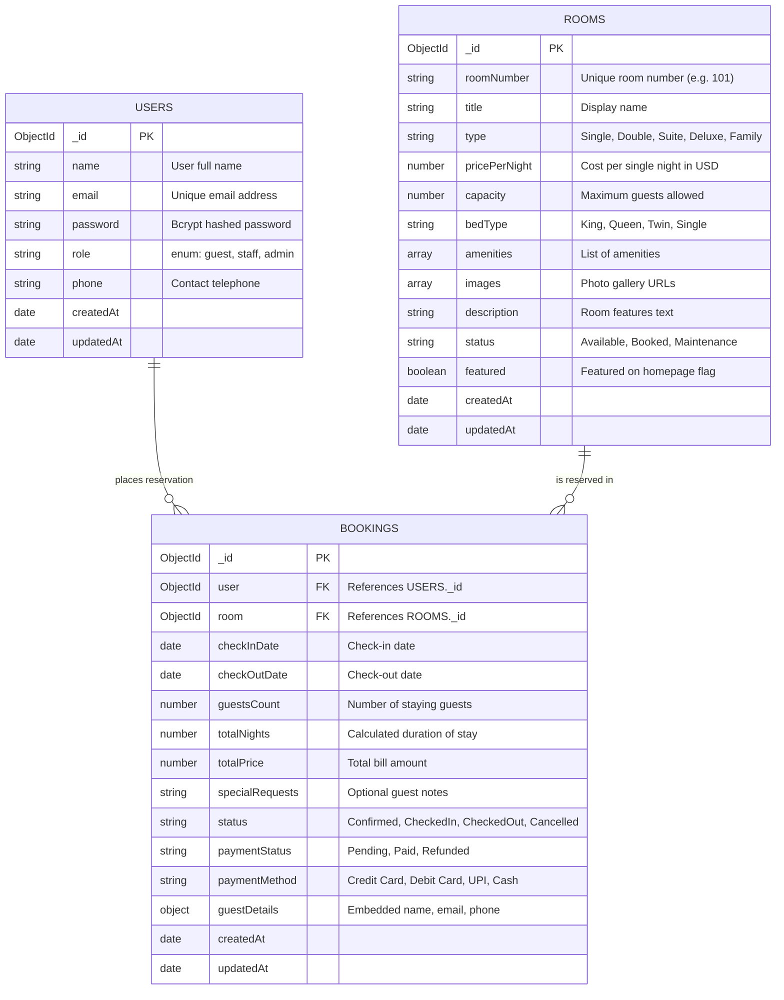
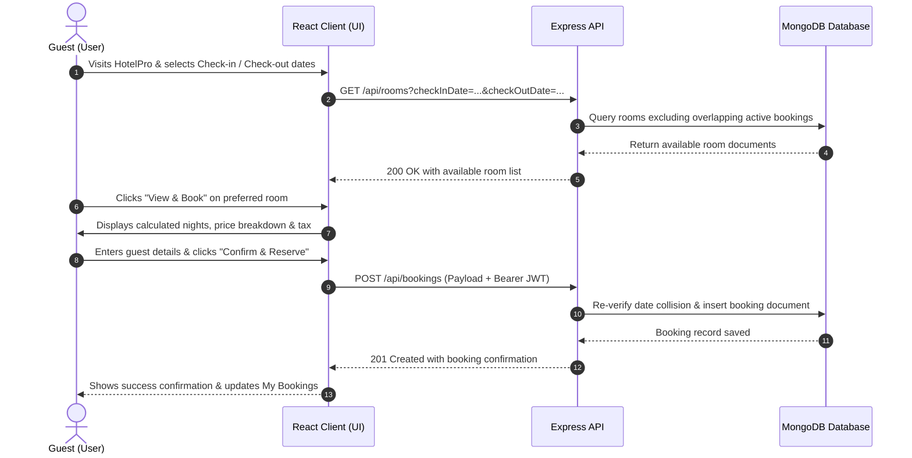
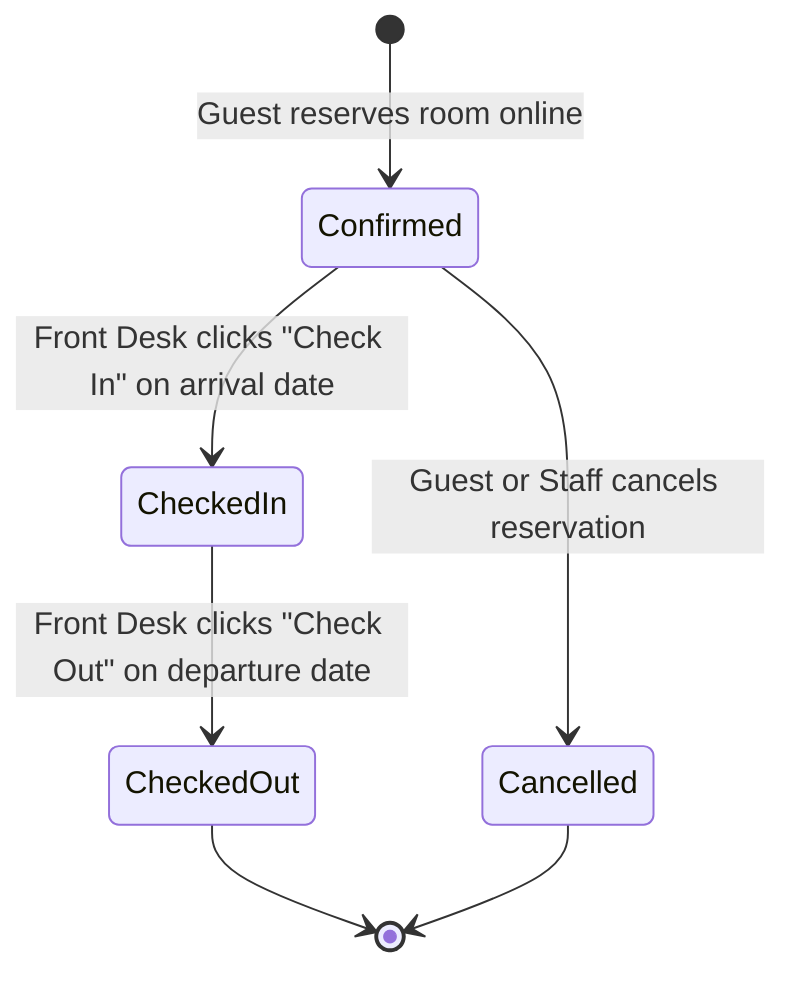

# 🏨 HotelPro: Complete Hotel Booking & Management Solution
## Skill Wallet Project Submission & Technical Architecture Report

---

> [!NOTE]
> This documentation is organized into the exact **6 Epics** and **19 Tasks** defined in your **Skill Wallet** curriculum. You can directly reference and use this content to submit each section on your dashboard.

---

# Table of Contents
1. [Epic 1: Project Architecture](#epic-1-project-architecture)
   - [Task 1: Technical Architecture](#task-1-technical-architecture)
   - [Task 2: ER Diagram & Data Dictionary](#task-2-er-diagram--data-dictionary)
   - [Task 3: Features & Capabilities](#task-3-features--capabilities)
   - [Task 4: Roles and Responsibilities Matrix](#task-4-roles-and-responsibilities-matrix)
   - [Task 5: User Flow & Lifecycle Diagrams](#task-5-user-flow--lifecycle-diagrams)
   - [Task 6: MVC Pattern Implementation](#task-6-mvc-pattern-implementation)
2. [Epic 2: Project Setup and Configuration](#epic-2-project-setup-and-configuration)
   - [Task 7: Creating Project Folder](#task-7-creating-project-folder)
   - [Task 8: Client Setup](#task-8-client-setup)
   - [Task 9: Server Setup](#task-9-server-setup)
3. [Epic 3: Backend Development](#epic-3-backend-development)
   - [Task 10: Backend Structure](#task-10-backend-structure)
   - [Task 11: Development and Code Explanation](#task-11-development-and-code-explanation)
4. [Epic 4: Database Development](#epic-4-database-development)
   - [Task 12: Configure MongoDB](#task-12-configure-mongodb)
   - [Task 13: Create Database Connection](#task-13-create-database-connection)
   - [Task 14: Create Schemas and Models](#task-14-create-schemas-and-models)
5. [Epic 5: Frontend Development](#epic-5-frontend-development)
   - [Task 15: Frontend Structure](#task-15-frontend-structure)
   - [Task 16: Development and UI Explanation](#task-16-development-and-ui-explanation)
6. [Epic 6: Project Execution](#epic-6-project-execution)
   - [Task 17: Steps for Project Execution](#task-17-steps-for-project-execution)
   - [Task 18: Output Screenshots Guide](#task-18-output-screenshots-guide)
   - [Task 19: Demo Video Recording Script](#task-19-demo-video-recording-script)

---

# Epic 1: Project Architecture

## Task 1: Technical Architecture

HotelPro is built upon a **Decoupled 3-Tier Client-Server Architecture** utilizing the **MERN** technology stack:
- **Presentation Tier (Client)**: A Single Page Application (SPA) powered by **React.js 18** and styled with **Bootstrap 5**. It maintains client-side application state, manages JWT tokens in local storage, handles dynamic client-side routing via `react-router-dom`, and communicates with the backend asynchronously through an Axios HTTP client.
- **Application Tier (Server)**: A RESTful micro-service built on **Node.js** and **Express.js**. It exposes secure REST endpoints, authenticates requests via **JSON Web Tokens (JWT)**, enforces role-based access control (RBAC), applies collision detection algorithms to prevent overlapping room bookings, and manages business logic.
- **Data Tier (Database)**: An enterprise document database utilizing **MongoDB** and mapped through **Mongoose ODM**. It provides schema validation, indexed search lookups, referential integrity across users, rooms, and bookings, and transaction aggregation pipelines for financial metrics.



---

## Task 2: ER Diagram & Data Dictionary

### Entity-Relationship Diagram



### Data Dictionary

| Collection | Field Name | Data Type | Constraints | Description |
|---|---|---|---|---|
| **Users** | `_id` | ObjectId | Primary Key | MongoDB Unique Identifier |
| | `name` | String | Required, Max 60 chars | User's full name |
| | `email` | String | Required, Unique, Lowercase | Validated email address |
| | `password` | String | Required, Min 6 chars, Select: false | Salted bcrypt hash |
| | `role` | String | Enum: `['guest', 'staff', 'admin']` | Authorization access level |
| | `phone` | String | Optional | Contact phone number |
| **Rooms** | `_id` | ObjectId | Primary Key | MongoDB Unique Identifier |
| | `roomNumber` | String | Required, Unique, Trimmed | Identification (e.g., 201) |
| | `title` | String | Required | Room title (e.g., Executive King Suite) |
| | `type` | String | Enum: Single, Double, Suite, Deluxe, Family | Category classification |
| | `pricePerNight` | Number | Required, Min: 0 | Rate per calendar night |
| | `capacity` | Number | Required, Min: 1 | Max allowed guests |
| | `amenities` | Array of Strings | Default list | List of facilities included |
| | `status` | String | Enum: Available, Booked, Maintenance | Current room status |
| **Bookings**| `_id` | ObjectId | Primary Key | MongoDB Unique Identifier |
| | `user` | ObjectId | Required, Ref: 'User' | Booking creator ID |
| | `room` | ObjectId | Required, Ref: 'Room' | Reserved room ID |
| | `checkInDate` | Date | Required | Reservation arrival date |
| | `checkOutDate` | Date | Required, > checkInDate | Reservation departure date |
| | `totalNights` | Number | Required, Min: 1 | Nights between in and out |
| | `totalPrice` | Number | Required | `totalNights * room.pricePerNight` |
| | `status` | String | Enum: Confirmed, CheckedIn, CheckedOut, Cancelled | Current reservation status |
| | `paymentStatus`| String | Enum: Pending, Paid, Refunded | Transaction status |

---

## Task 3: Features & Capabilities

1. **User Authentication & Session Security**:
   - Secure account registration and token-based authentication via JSON Web Tokens (JWT).
   - Passwords securely salted and hashed using `bcryptjs` with cost factor 10.
   - Built-in demo role switchers for instantaneous testing by project evaluators.
2. **Room Search & Live Filtering**:
   - Dynamic search by room number, title, or keywords.
   - Categorical filters (Single, Double, Suite, Deluxe, Family).
   - Capacity selectors and real-time interactive price slider (up to \$500/night).
   - Date range availability verification that excludes rooms with conflicting reservations.
3. **Reservation Engine with Double-Booking Prevention**:
   - Automated date arithmetic calculating total nights and overall stay price.
   - Database collision guard preventing multiple guests from reserving the same room for overlapping dates.
   - Instant booking confirmation and user receipt generation.
4. **Guest Self-Service Portal**:
   - Reservation overview displaying active, upcoming, and past stays.
   - Automated self-cancellation with simulated refund issuance.
5. **Front Desk & Management Operations**:
   - Live KPI Dashboard calculating Gross Revenue, Available Rooms, Occupied Rooms, and Active Bookings.
   - Full room inventory CRUD with modal interfaces to add, edit, or decommission rooms.
   - One-click Front Desk status updates: transition guests from `Confirmed` $\rightarrow$ `CheckedIn` $\rightarrow$ `CheckedOut`.

---

## Task 4: Roles and Responsibilities Matrix

| Feature / Action | Guest / Customer | Front Desk Staff | Administrator |
|---|:---:|:---:|:---:|
| Browse Room Catalog & Check Rates | ✅ | ✅ | ✅ |
| Filter by Date Availability & Room Type | ✅ | ✅ | ✅ |
| Reserve Room & Checkout | ✅ | ✅ | ✅ |
| View Personal Bookings | ✅ | ✅ | ✅ |
| Cancel Personal Reservation | ✅ | ✅ | ✅ |
| Access Management Portal | ❌ | ✅ | ✅ |
| Update Guest Check-In / Check-Out Status | ❌ | ✅ | ✅ |
| View Overall Revenue & Statistics | ❌ | ✅ | ✅ |
| Create New Rooms in Inventory | ❌ | ✅ | ✅ |
| Modify Existing Room Details & Pricing | ❌ | ✅ | ✅ |
| Delete Rooms from System | ❌ | ❌ | ✅ |

---

## Task 5: User Flow & Lifecycle Diagrams

### Guest Booking Journey


### Front Desk Check-in / Check-out Lifecycle


---

## Task 6: MVC Pattern Implementation

The backend follows the industry-standard **Model-View-Controller (MVC)** architectural design:
- **Model**: Located in `server/models/`. Mongoose models (`User.js`, `Room.js`, `Booking.js`) define data structure, type casting, default values, pre-save encryption middleware, and helper methods.
- **View**: Located in `client/src/pages/` and `client/src/components/`. The React client renders responsive HTML5 and Bootstrap user interfaces, decoupled from the server.
- **Controller**: Located in `server/controllers/`. Functions (`authController.js`, `roomController.js`, `bookingController.js`, `statsController.js`) process incoming HTTP requests, orchestrate database operations, validate business rules, and send formatted JSON responses.
- **Routing Layer**: Located in `server/routes/`. Connects specific URL endpoints with authorization middlewares and controller functions.

---

# Epic 2: Project Setup and Configuration

## Task 7: Creating Project Folder
The project is organized in a decoupled monorepo structure separating the client and server:
- Root directory containing centralized execution scripts (`package.json`) and project documentation (`README.md`).
- `server/`: Dedicated Node.js backend workspace containing configuration, models, controllers, routes, and environment settings.
- `client/`: Dedicated React.js frontend workspace containing source components, views, context providers, assets, and styling.

## Task 8: Client Setup
1. Created with React 18 and standard script configuration.
2. Production dependencies installed:
   - `react` & `react-dom`: Declarative UI component engine.
   - `react-router-dom`: Client-side single page navigation.
   - `axios`: Promise-based HTTP client for API communication.
   - `bootstrap` & `bootstrap-icons`: Responsive layout grid, buttons, and iconography.
3. Configured proxy to route API requests to `http://localhost:5000`.

## Task 9: Server Setup
1. Node.js runtime configured with Express.js micro-framework.
2. Dependencies installed:
   - `express`: Core REST API web server.
   - `mongoose`: MongoDB Object Data Modeling (ODM).
   - `dotenv`: Environment variable loader from `.env`.
   - `cors`: Cross-Origin Resource Sharing configuration.
   - `jsonwebtoken`: Secure user token generation and verification.
   - `bcryptjs`: Password cryptographic hashing.
   - `morgan`: HTTP request logging for development.
3. Created environment configuration `.env` specifying `PORT`, `MONGO_URI`, and `JWT_SECRET`.

---

# Epic 3: Backend Development

## Task 10: Backend Structure
```
server/
├── config/
│   └── db.js                 # Database connection logic
├── controllers/
│   ├── authController.js     # User registration, login, profile
│   ├── roomController.js     # Room CRUD, search, date filtering
│   ├── bookingController.js  # Booking creation, overlap checks, cancellations
│   └── statsController.js    # Operations KPI analytics aggregator
├── middleware/
│   ├── authMiddleware.js     # Token verification & role checking
│   └── errorMiddleware.js    # 404 & global exception handlers
├── models/
│   ├── User.js               # User entity schema
│   ├── Room.js               # Room entity schema
│   └── Booking.js            # Booking entity schema
├── routes/
│   ├── authRoutes.js         # /api/auth routes
│   ├── roomRoutes.js         # /api/rooms routes
│   ├── bookingRoutes.js      # /api/bookings routes
│   └── statsRoutes.js        # /api/stats routes
├── .env                      # Environment secrets
├── seeder.js                 # Automatic sample data seeder
└── server.js                 # Express server entry point
```

## Task 11: Development and Code Explanation

### 1. Collision Prevention Algorithm (`bookingController.js`)
To prevent two guests from booking the same room for overlapping dates:
```javascript
const overlapping = await Booking.findOne({
  room: roomId,
  status: { $in: ['Pending', 'Confirmed', 'CheckedIn'] },
  $or: [
    {
      checkInDate: { $lt: checkOut },
      checkOutDate: { $gt: checkIn },
    },
  ],
});

if (overlapping) {
  return res.status(400).json({
    success: false,
    message: 'Sorry, this room is already booked for the selected dates.',
  });
}
```

### 2. JWT Verification Middleware (`authMiddleware.js`)
Extracts the Bearer token, verifies its signature against `JWT_SECRET`, looks up the user, and attaches it to `req.user`:
```javascript
const protect = async (req, res, next) => {
  let token;
  if (req.headers.authorization && req.headers.authorization.startsWith('Bearer')) {
    token = req.headers.authorization.split(' ')[1];
  }
  if (!token) {
    return res.status(401).json({ success: false, message: 'Access denied. No token provided.' });
  }
  const decoded = jwt.verify(token, process.env.JWT_SECRET);
  req.user = await User.findById(decoded.id);
  next();
};
```

---

# Epic 4: Database Development

## Task 12: Configure MongoDB
MongoDB connection parameters are externalized in `.env`:
- Local Database: `mongodb://127.0.0.1:27017/hotelpro`
- Cloud Alternative: `mongodb+srv://<username>:<password>@cluster.mongodb.net/hotelpro?retryWrites=true&w=majority`

## Task 13: Create Database Connection
Implemented in `server/config/db.js`:
```javascript
const mongoose = require('mongoose');

const connectDB = async () => {
  try {
    const conn = await mongoose.connect(process.env.MONGO_URI || 'mongodb://127.0.0.1:27017/hotelpro', {
      serverSelectionTimeoutMS: 5000,
    });
    console.log(`[Database] MongoDB Connected: ${conn.connection.host}`);
  } catch (error) {
    console.error(`[Database Error] Connection Failed: ${error.message}`);
  }
};

module.exports = connectDB;
```

## Task 14: Create Schemas and Models
Three schemas are defined:
1. **User Schema**: Enforces unique, lowercase emails, minimum 6-character passwords, pre-save hashing with bcrypt, and role definitions (`guest`, `staff`, `admin`).
2. **Room Schema**: Enforces unique `roomNumber`, room category enum (`Single`, `Double`, `Suite`, `Deluxe`, `Family`), capacity limits, and amenity string arrays.
3. **Booking Schema**: Holds ObjectIds referencing `User` and `Room`, check-in/out dates, price calculations, and lifecycle statuses.

---

# Epic 5: Frontend Development

## Task 15: Frontend Structure
```
client/src/
├── components/
│   ├── Navbar.js           # Dynamic navigation bar with role badges
│   ├── Footer.js           # Responsive footer
│   ├── RoomCard.js         # Card component with image, tags & pricing
│   └── ProtectedRoute.js   # Client-side RBAC route protector
├── context/
│   └── AuthContext.js      # Global authentication state
├── pages/
│   ├── Home.js             # Hero banner, search bar & featured rooms
│   ├── Rooms.js            # Catalog with filters, search, price slider
│   ├── RoomDetail.js       # Gallery, amenities & dynamic night calculator
│   ├── Login.js            # Sign in with 1-Click quick fill demo buttons
│   ├── Register.js         # User registration form
│   ├── UserDashboard.js    # Guest reservation management & cancellation
│   └── AdminDashboard.js   # Front desk ops, room CRUD & KPI cards
├── services/
│   └── api.js              # Axios instance with Bearer interceptor
├── App.js                  # Route declarations
└── index.js                # React root mount
```

## Task 16: Development and UI Explanation
- **Live Dynamic Price Calculator (`RoomDetail.js`)**: Automatically calculates nights between arrival and departure dates, displays subtotal, computes 10% taxes and fees, and renders the grand total dynamically.
- **Role-Based Guards (`ProtectedRoute.js`)**: Prevents unauthenticated users from accessing booking dashboards, and restricts operational controls to staff and admin accounts.
- **Operations Hub (`AdminDashboard.js`)**: Implements tab switching between room inventory management (with an interactive modal for adding and updating rooms) and reservations management (with front desk check-in / check-out action buttons).

---

# Epic 6: Project Execution

## Task 17: Steps for Project Execution

### Step 1: Install Dependencies
```bash
# In the server directory:
cd server
npm install

# In the client directory:
cd ../client
npm install
```

### Step 2: Seed the Database
```bash
cd ../server
npm run seed
```
> **Console Output:**
> ```
> [Seeder] Connected to MongoDB...
> [Seeder] Cleared existing Users, Rooms, and Bookings.
> [Seeder] Seeded 3 users (Admin, Staff, Guest).
> [Seeder] Seeded 6 rooms.
> [Seeder] Seeded 1 demo booking.
> ✅ DATABASE SEEDING COMPLETED SUCCESSFULLY!
> ```

### Step 3: Run the Application
1. **Start Backend Server**:
   ```bash
   cd server
   npm run dev
   # Server runs at http://localhost:5000
   ```
2. **Start Frontend Client** (in a second terminal):
   ```bash
   cd client
   npm start
   # Browser opens http://localhost:3000
   ```

---

## Task 18: Output Screenshots Guide

Capture the following 6 screenshots to upload for your Skill Wallet submission:
1. **Homepage (`/`)**: Displays the hero banner, date-search bar, feature highlights, and featured rooms.
2. **Room Catalog (`/rooms`)**: Shows search filters, room type pills, max price slider, and responsive room cards.
3. **Room Booking & Calculator (`/rooms/:id`)**: Shows room specifications, amenity chips, date selection inputs, and the total price breakdown box.
4. **Sign In Page (`/login`)**: Shows the login card and the **1-Click Quick Fill Demo buttons** (`Admin`, `Staff`, `Guest`).
5. **Guest Dashboard (`/dashboard`)**: Displays active reservations with status badges and the "Cancel" action.
6. **Operations & Admin Portal (`/admin`)**: Shows the 4 KPI metric cards (Total Rooms, Available Rooms, Active Bookings, Total Revenue) and the Room Catalog Table with the "Add New Room" modal.

---

## Task 19: Demo Video Recording Script

> [!TIP]
> Use this 3-minute walk-through script when recording your screen for the mentor review video.

### Video Timeline & Script:

- **0:00 - 0:30 | Project Introduction**:
  > *"Hello! This is HotelPro, a complete hotel booking and operations management solution built using the MERN stack and Bootstrap 5 for the Skill Wallet project submission. It provides real-time room booking, conflict-free scheduling, and a full front-desk operations suite."*

- **0:30 - 1:15 | Guest Journey (Search & Booking)**:
  > *"As a guest, I can browse rooms on the homepage or head to the Room Catalog. Here, I can filter rooms by category, search by keywords, or adjust the price slider. When I select a room, the booking engine dynamically calculates the number of nights, subtotal, and taxes based on my check-in and check-out dates. Clicking 'Confirm & Reserve' instantly secures the room."*

- **1:15 - 1:45 | Guest Dashboard & Cancellation**:
  > *"Heading over to 'My Bookings', the guest can review all active reservations. If plans change, the guest can cancel their reservation with a single click, which updates the status to 'Cancelled' and issues a simulated refund."*

- **1:45 - 2:30 | Operations & Admin Portal**:
  > *"Logging in as the Hotel Manager or Staff, we access the Management Portal. At the top, we see real-time KPIs: total rooms, available rooms, active reservations, and gross revenue. In the Rooms tab, staff can add, edit, or remove rooms. In the All Bookings tab, front desk staff can transition guests through the reservation lifecycle from 'Confirmed' to 'Checked In' and 'Checked Out'."*

- **2:30 - 3:00 | Code Architecture & Wrap-Up**:
  > *"The backend is structured under the MVC pattern with JWT authentication, Mongoose data models, and double-booking prevention logic. The frontend uses React with modular components and AuthContext. Thank you for reviewing HotelPro!"*

---
*(End of Submission Report)*
